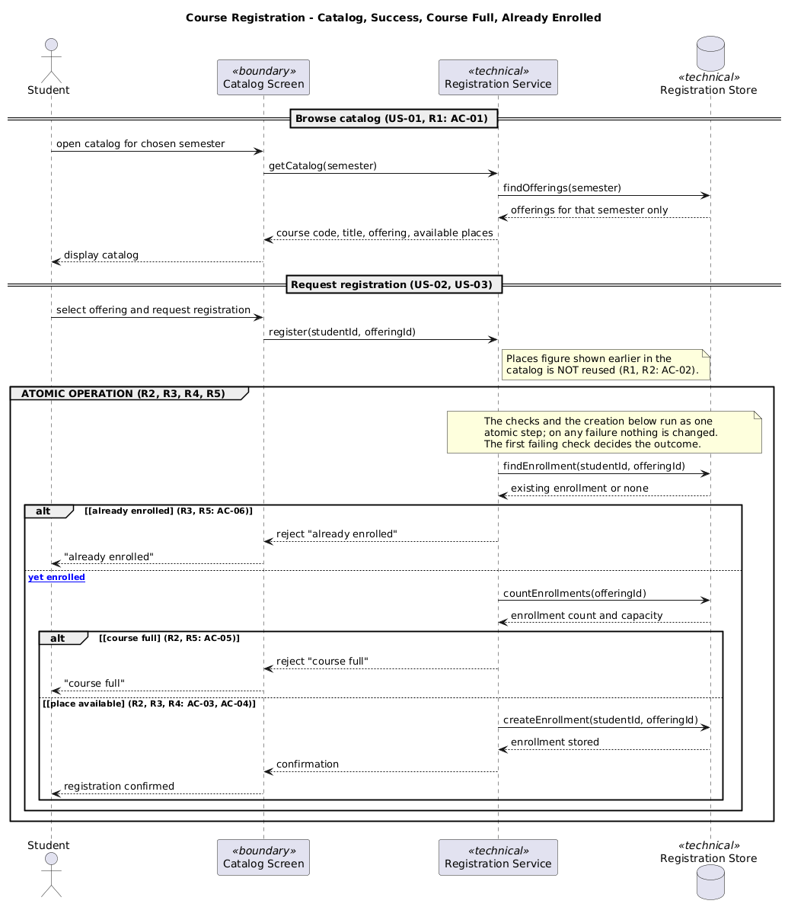
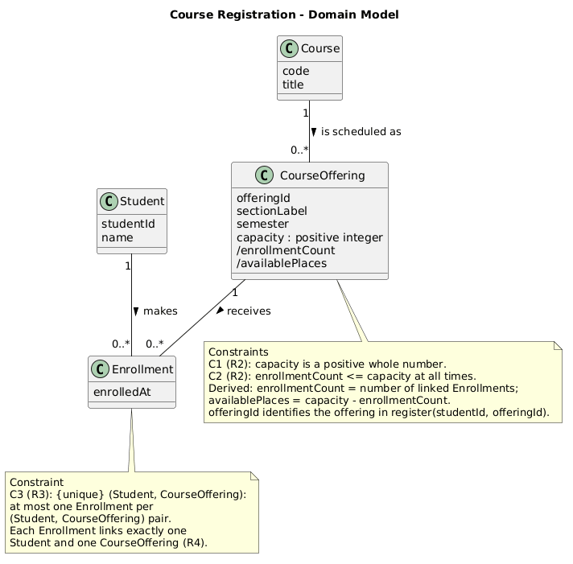
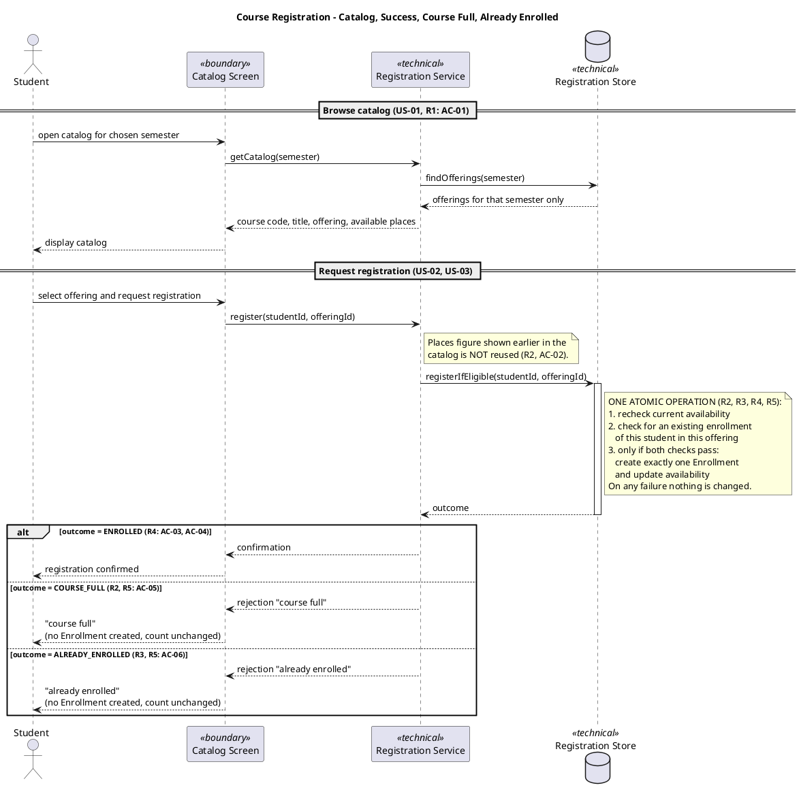
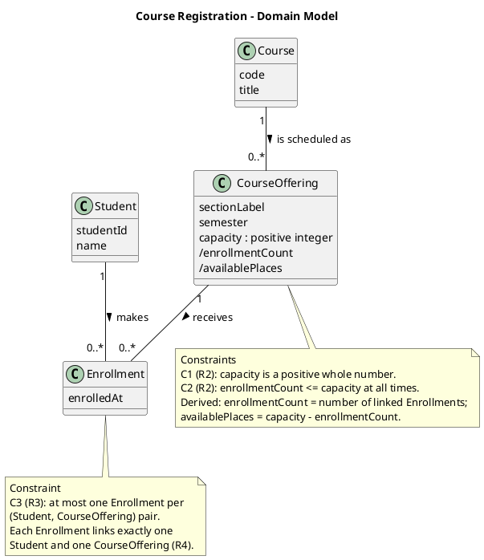
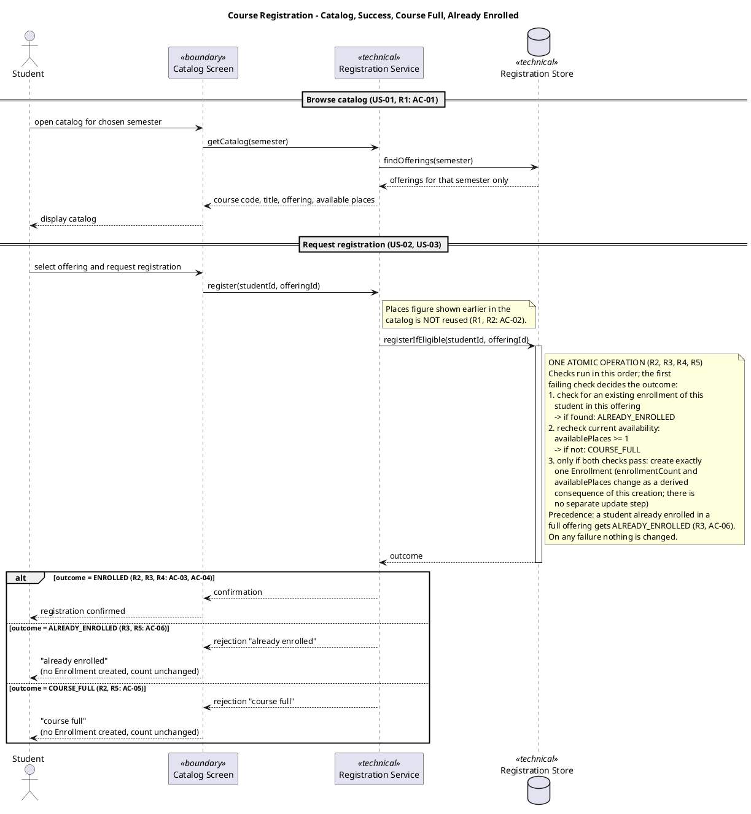
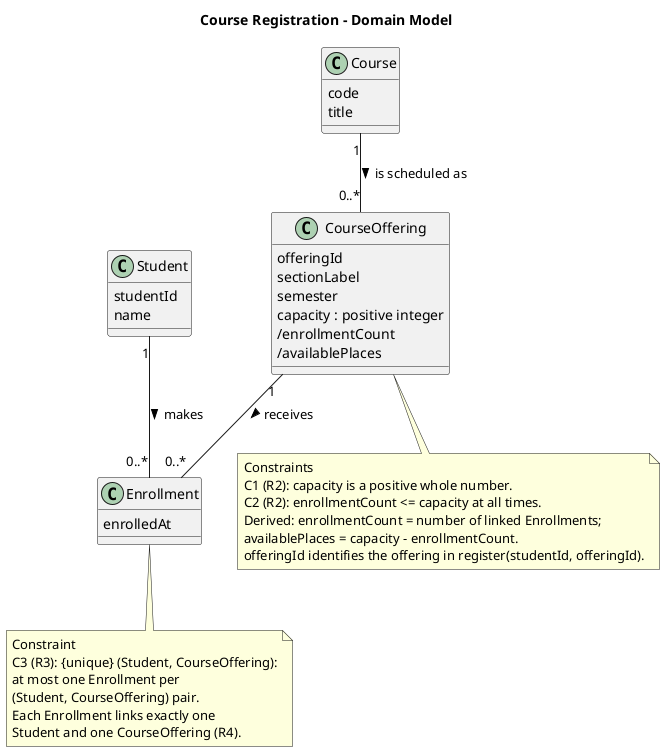
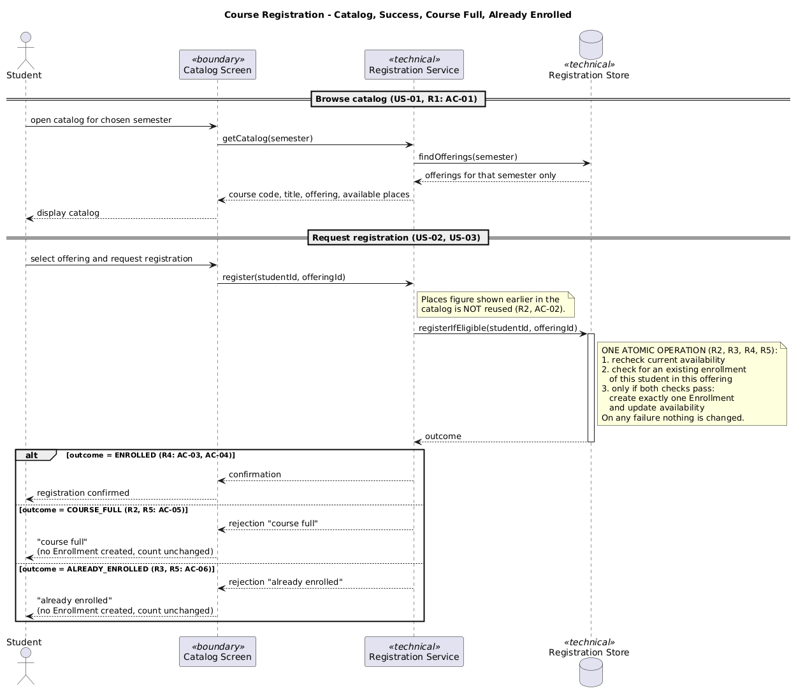
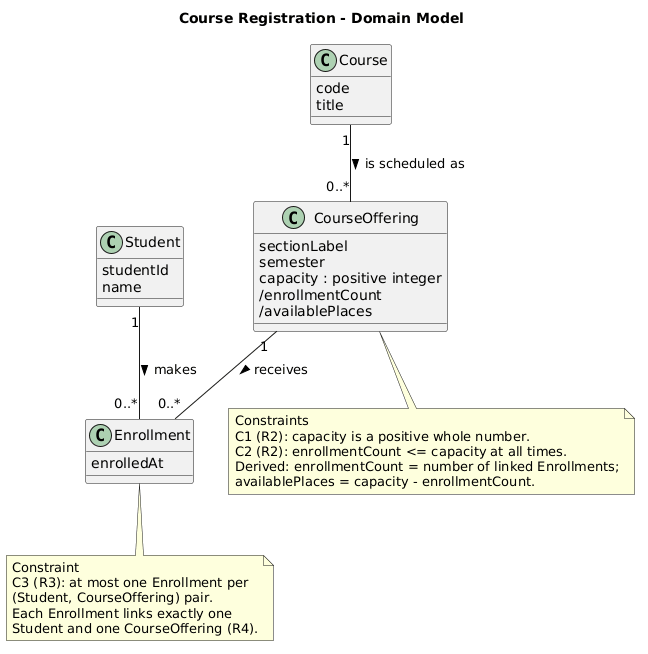

# SIS #02 — AI-Assisted UML Modeling: University Course Registration

<!--
  This is the only file you write your report in. README.md tells you what goes where.

  Rules the checker relies on:
  - Do not delete, rename or renumber the ## headings, the ### headings, or the **Label:** words.
  - Replace every "(write here)" and "(paste here)". None may be left when you submit.
  - Comments like this one are ignored by the checker and the word counter. Delete them or leave them.
-->

## 1. Scope and assumptions

<!-- Your FINAL scope statement and assumptions, after reviewing Prompt A's output. Say here
     what is out of scope (payments, prerequisites, timetable clashes, waiting lists,
     cancellation) — section 2 must not mention them. Section 10 keeps your first version. -->

**Scope:** A signed-in student searches for a course catalog for one semester, sees each available places, and registers for a specific course. After what the system rechecks current availability at the moment of registration, creates at most one enrollment per student per offering, and either confirms the registration or rejects it with a clear reason, keeping enrollment count never above capacity. Payments, prerequisites, timetable clashes, waiting lists and cancellation are out of scope

**Assumptions:**

1. The student already signed in
2. An offering's capacity is a fixed positive whole number set before registration opens and only the enrollment count changes, and only through successful registrations, since cancellation is excluded
3. The final availability check and the creation of the Enrollment happen as one atomic operation, so two students requesting the last place cannot both succeed
4. A rejection reason conveys the meaning "course full" or "already enrolled" and the exact wording shown to the student is an implementation detail, not fixed by R5
5. A confirmation on success states at minimum the course code and the offering so its full content beyond that is an implementation detail, not fixed by R4

## 2. User stories and acceptance criteria

<!-- Your APPROVED requirements: Prompt A's draft after your review. Keep the IDs, the three
     story headings and the bullet shape. Every criterion names the rule(s) it maps to,
     e.g. (R2, R4). Two criteria per story. Nothing out of scope.
     Format of a criterion, on one bullet:
     - **AC-03** (R2, R4): Given ..., When ..., Then ... -->

### US-01 — Browse offerings

**US-01:** As a student, I want to see the courses offered in a chosen semester with their available places, so that I can pick an offering that still has room

- **AC-01** (R1): Given a semester that has offerings, When the student opens the catalog for that semester, Then each offering is listed with course code, title, offering and available places and only that semester's offerings appear
- **AC-02** (R1, R2): Given the catalog is displayed and an offering's enrollment count has since changed, When the student requests registration for that offering, Then the system rechecks current availability at that moment rather than relying on the places figure shown earlier

### US-02 — Register for an offering

**US-02:** As a student, I want to register for an offering that has a free place, so that I get an enrollment and a confirmation.

- **AC-03** (R2, R3, R4): Given a student with no enrollment in offering MAR101-A and that offering has at least one free place, When she requests registration, Then exactly one Enrollment linking the student and MAR101-A is created, available places decrease by one, and a confirmation is returned.
- **AC-04** (R2, R4): Given an offering with capacity 30 and 29 enrollments, When a student with no enrollment in it registers, Then the registration succeeds and the enrollment count becomes 30, never above 30.

### US-03 — Receive a clear rejection

**US-03:** As a student, I want a clear reason when my registration cannot be completed, so that I know whether the offering is full or I am already enrolled.

- **AC-05** (R2, R5): Given an offering whose enrollment count equals its capacity, When a student not enrolled in it requests registration, Then the request is rejected with the reason "course full", no Enrollment is created, and the enrollment count is unchanged.
- **AC-06** (R3, R5): Given a student already has an enrollment in offering HIS210-B, When he requests registration for that same offering again, Then the request is rejected with the reason "already enrolled", no second Enrollment is created, and the enrollment count is unchanged.


## 3. Sequence diagram

<!-- The FINAL diagram, rendered. Change .png to .svg if that is what you exported. -->



**Participants:** The Student is the actor who browses the catalog and requests a registration. The Catalog Screen is the user interface that displays the catalog and the outcome messages. The Registration Service receives `getCatalog` and `register` requests from the screen, passes them on to the store, and returns the outcome to the screen. The Registration Store holds the offerings and enrollments and runs the checks and the creation of an Enrollment

**Atomic operation:** The single message `registerIfEligible(studentId, offeringId)` from the Registration Service to the Registration Store is the one atomic step. Inside it, in this order, are (1) the final duplicate check, (2) the capacity check (`availablePlaces >= 1`, otherwise `COURSE_FULL`) and (3) the creation of exactly one Enrollment, only if both checks pass. Because the steps are indivisible, two students cannot both take the last place, and on any failure nothing is changed. A catalog view reserves nothing: `getCatalog` / `findOfferings` is read-only, and the places figure it shows is only a snapshot that may be outdated by the time the student registers. That is why `register` does not reuse it and the store rechecks availability inside the atomic operation

**Where the Enrollment is created:** In the message `registerIfEligible(studentId, offeringId)`, on the *Registration Store* lifeline, in step 3 of the atomic operation, and only when the outcome is `ENROLLED`. It produces one instance of the class Enrollment from section 4, linked to the Student and the CourseOffering. `enrollmentCount` and `availablePlaces` change only as a derived consequence

**Technical lifelines:** Catalog Screen, Registration Service and Registration Store are not classes in the class diagram. The class diagram is a domain model: it describes business concept and their rules, independent of any implementation. The sequence diagram shows how the system realizes a use case, so it also needs the UI, the service and the storage. This difference in abstraction is fine, because the technical lifelines only carry out the operations on domain objects and add no new domain concepts. The actor corresponds to the class Student

## 4. Class diagram

<!-- The FINAL diagram, rendered. -->



<!-- One row per association in classes.puml, read in both directions. -->

| Association | Read left to right | Read right to left |
| --- | --- | --- |
| Course – CourseOffering | One Course is scheduled as zero or more CourseOfferings | Each CourseOffering is a scheduling of exactly one Course |
| Student – Enrollment | One Student makes zero or more Enrollments | Each Enrollment is made by exactly one Student |
| CourseOffering – Enrollment | One CourseOffering receives zero or more Enrollments | Each Enrollment is received by exactly one CourseOffering |

**How an Enrollment links a student to an offering:** Student and CourseOffering are in a many-to-many relationship (a student can take many offerings, an offering has many students). The class Enrollment resolves it into two one-to-many associations. Each Enrollment has exactly one Student ("1" on the Student side) and exactly one CourseOffering ("1" on the CourseOffering side), so it represents one registration of one student in one offering. The offerings of a student are found through their Enrollments, and the students of an offering through the offering's Enrollments

**Capacity constraint:** C2: `enrollmentCount <= capacity` at all times, where `enrollmentCount` is the number of linked Enrollments and `capacity` is a positive whole number (C1). Multiplicity alone cannot express it, because the multiplicity "0..*" is a fixed bound written in the diagram. The capacity differs for every offering and is stored as an attribute value, and a multiplicity cannot refer to the value of an attribute. The rule therefore has to be a separate constraint (e.g. OCL: `self.enrollment->size() <= self.capacity`), enforced in the atomic operation

**Uniqueness constraint:** `{unique}` (Student, CourseOffering): at most one Enrollment per (Student, CourseOffering) pair. Multiplicity alone cannot express it, because each multiplicity counts the links at one end of one association separately (a Student has 0..* Enrollments, an offering has 0..* Enrollments). Neither says anything about the combination of the two ends, so the same student could still have two Enrollments in the same offering. A constraint on the pair is needed, enforced by the duplicate check in the atomic operation

## 5. Traceability

<!-- Every rule, including the catalog fields and availability (R1). Column 1: the rule and
     the criteria that cover it, e.g. "R2 + AC-03, AC-04". Column 2: the message, guard,
     class or constraint that shows the rule in YOUR diagrams. Column 3: the T-ID that
     exercises it, or the extra check you did instead (R1 has no T case). -->

| Rule and criterion | Model evidence | Validation case |
| --- | --- | --- |
| R1 + AC-01, AC-02 | Sequence: `getCatalog(semester)` -> `findOfferings(semester)` returns only that semester's offerings with course code, title, offering and available places. Note "places figure shown earlier is NOT reused". Class: Course, CourseOffering (semester, /availablePlaces) | No T case for R1. Extra check is traced the catalog section of the diagram and confirmed every catalog field exists as an attribute in CourseOffering or Course, and that `register` rechecks availability instead of reusing the catalog figure |
| R2 + AC-02, AC-03, AC-05 | Sequence: step 2 of the atomic note, `availablePlaces >= 1`, else `COURSE_FULL`. Class: constraints C1 and C2 (`enrollmentCount <= capacity`) | T1, T2, T3 |
| R3 + AC-04, AC-06 | Sequence: step 1 of the atomic note checks for an existing enrollment, else `ALREADY_ENROLLED`; precedence over `COURSE_FULL`. Class: constraint C3 `{unique}` (Student, CourseOffering) | T4 |
| R4 + AC-03, AC-04 | Sequence: step 3 creates exactly one Enrollment, only if both checks pass, and the confirmation is sent only in the `ENROLLED` branch. Class: Enrollment linked to exactly one Student and one CourseOffering ("1" on both sides) | T1, T2 |
| R5 + AC-05, AC-06 | Sequence: "On any failure nothing is changed"; the `COURSE_FULL` and `ALREADY_ENROLLED` branches create no Enrollment and the count is unchanged | T3, T4 |

## 6. Walkthroughs

<!-- Walk each case through YOUR final sequence diagram, message by message. Column 2: the
     actual steps and the state change (count before → after). Column 3 starts with Pass or
     Fail, then the location: the message, guard or note where you saw it. A Fail you
     report honestly is a finding, not a penalty. -->

| Case | Observed path and state change | Judgment and evidence |
| --- | --- | --- |
| T1. Available | Student opens the catalog and selects the offering. UI sends `register(studentId, offeringId)` to the service, which sends `registerIfEligible` to the store. Step 1 finds no existing enrollment, step 2 finds 2 places (>= 1), step 3 creates one Enrollment. The outcome `ENROLLED` goes back as a confirmation. Count: 0 -> 1. | Pass. Seen in the `registerIfEligible` note (steps 1-3) and the `alt outcome = ENROLLED` branch, where the confirmation is sent only after the Enrollment is created |
| T2. Last place | Same path as T1 for a new student. Step 1 finds no enrollment, step 2 finds `availablePlaces` = 1 (>= 1, so the check passes), step 3 creates the Enrollment. Count: 1 -> 2, so availablePlaces becomes 0 as a derived value | Pass. Seen in step 2 of the note: the condition is `>= 1`, so the last place is accepted, and C2 (`enrollmentCount <= capacity`) still holds with 2 of 2 |
| T3. Full | The catalog showed a place, but 2 of 2 are now taken. `register` ignores the old catalog figure (note on the Registration Service). In the store, step 1 finds no enrollment, step 2 finds `availablePlaces` = 0 and fails. Outcome `COURSE_FULL`, the student sees "course full". Count stays 2, no Enrollment created | Pass. Seen in the note "Places figure shown earlier is NOT reused", step 2 of the atomic note, and the `alt outcome = COURSE_FULL` branch ("count unchanged") |
| T4. Duplicate | The student who is already enrolled (count 1 of 2) requests again. Step 1 finds an existing Enrollment for this student and offering, so the checks stop at once with `ALREADY_ENROLLED`. The student sees "already enrolled". Count stays 1, no second Enrollment | Pass. Seen in step 1 of the atomic note (first failing check decides) and the `alt outcome = ALREADY_ENROLLED` branch. C3 in the class diagram forbids a second pair |

## 7. Review decisions

<!-- At least three substantive decisions about Prompt C's critique or your own inspection.
     Decision: accepted / rejected / modified — and what you did. Reason: why, in a full
     sentence. Rule: R1–R5. Do not invent an error to fill the table; a justified rejection
     of advice counts. -->

| AI suggestion or model element | Decision | Reason | Rule |
| --- | --- | --- | --- |
| D1 — check order is undefined when the offering is full and the student is already enrolled. The note's order would wrongly return "course full" instead of "already enrolled" | accept | AC-06 has no "not full" condition while AC-05 requires "not enrolled", so duplicate must be checked first; I reordered the atomic steps and made the precedence explicit | `registerIfEligible` note; `alt` branches; AC-05, AC-06 |
| D2 — `offeringId` used in `register(studentId, offeringId)` has no counterpart field in `CourseOffering`, so R4's "links exactly one CourseOffering" cannot be verified against the class model | accept | Added an `offeringId` attribute to `CourseOffering` so both diagrams refer to the same identity | sequence `register()` call vs. class `CourseOffering` |
| D3 — "update availability" as a separate step contradicts `/availablePlaces` being derived and a separate update implies a stored field that could drift from the real count | accept | Reworded the step to say availability changes as a consequence of creating the Enrollment, not as an independent update | atomic note step 3; class `/availablePlaces` |

## 8. Modeling explanation

<!-- 200–300 words. Your main design choices; how the class diagram and the sequence diagram
     complement each other; why an activity diagram could also help explain the workflow. -->

My main design choice was to keep the domain model separate from the technical workflow. The class diagram contains only business concepts like Student, Course, CourseOffering and Enrollment. I made Enrollment its own class instead of a direct many-to-many link, because a registration must be created, counted and checked for uniqueness. Enrollment count and available places are derived from linked Enrollments, so no separate counter can get out of sync. Rules that multiplicity cannot express are explicit constraints: positive capacity, enrollmentCount not above capacity, and one Enrollment per student and offering

The sequence diagram shows how these rules are applied at run time. Its key decision is that the duplicate check, the capacity check and the creation of the Enrollment happen in one atomic message, registerIfEligible, so two students cannot take the last place. The catalog is read-only and reserves nothing, so its places figure is never reused. The checks run in a fixed order, so an already enrolled student gets ALREADY_ENROLLED even when the offering is full.

The two diagrams complement each other: the class diagram states what must always be true, and the sequence diagram states when and in what order the system makes sure of it. Each constraint C1-C3 matches a step or branch in the sequence diagram

An activity diagram could also help explain the workflow. It would show the registration as one flow with decision nodes and three end states, making the precedence of the checks easy to read for non-technical readers without lifelines or messages

## 9. Reflection

<!-- 150–200 words. Written by you, not by the assistant: where AI helped, one decision you
     made yourself, one remaining limitation. Specific beats flattering. -->

(write here)

## 10. Appendix A — Before AI

<!-- Written BEFORE you run Prompt A, committed and pushed in your first commit, and never
     edited afterwards. This is what you paste into Prompt A as "My initial assumptions". -->

**Scope:** A stident that sighned searches for a course catalog for one semester and sees available choises, then register. The system checks for a number of students in that course and declines the accept if student already registered for this course

**Initial assumptions:**

1. If student already logged in the system, there is no need to logging in, account creation, authentication
2. The number of students in that course sets before the registration and it can't be changed. But except through enrollments and the exclusions the scenario names

## 11. Appendix B — AI exchanges

<!-- Complete prompts and complete responses, as text — never screenshots. Paste each inside
     the ~~~~ block that follows its label: AI responses contain ``` PlantUML blocks, and
     ~~~~ keeps them from breaking this file. Prompts B and C: the prompt text first, then
     the material it refers to ("below", "these two") pasted under it, in the same block.
     You may add B5, B6 … after B4 if you ran more. -->

### B1 — Requirements (Prompt A)

- **Tool:** Claude Free
- **Model:** Sonnet 5.5
- **Date:** 2026-10-18
- **Purpose:** draft 3 user stories and 6 acceptance criteria

<!-- Model: the exact model with its version, as the tool shows it (e.g. "GPT-5 Thinking",
     "Claude Sonnet 4.5"). If the tool does not show it, write: not displayed
     Date: YYYY-MM-DD -->

Act as a requirements analyst. Use only this course registration scenario and rules R1–R5:

A student browses an electronic course catalog, chooses a course offering and requests registration. Each offering has a limited number of places.

A Course describes a subject. A CourseOffering is one scheduled section in one semester. Registration always targets a specific offering.

Assume that the student is signed in, the selected offering exists, and its capacity is a positive whole number.

Exclude payments, prerequisites, timetable clashes, waiting lists and cancellation. Use fictional students and courses.

Rules:
R1. Catalog — Show the course code, title, offering and available places for one semester.
R2. Capacity — Recheck current availability when registering. Enrollment must never exceed the offering's capacity.
R3. Duplicates — A student may have at most one enrollment in the same offering. Reject a repeat request.
R4. Success — Create exactly one Enrollment linking the student and offering, update availability and return a confirmation.
R5. Rejection — Explain "course full" or "already enrolled". Create no enrollment and leave the enrollment count unchanged.

My initial assumptions are:
1. If the student is already logged in the system, there is no need for logging in, account creation, or authentication.
2. The number of students in that course is set before registration and cannot be changed, except through enrollments and the exclusions the scenario names.

Draft 3 user stories and 2 Given / When / Then acceptance criteria for each. Use IDs US-01 to US-03 and AC-01 to AC-06. Map each criterion to rule IDs.
Cover normal and rejection behavior. List uncertainty separately. Do not add excluded features or invent university policies.

**Response:**

# Course Registration: User Stories and Acceptance Criteria

## Assumption check

**Assumption 1** is consistent with the scenario ("the student is signed in"). I treat sign-in as out of scope.

**Assumption 2** needs a small correction. The scenario fixes only *capacity* (a positive whole number). The *enrollment count* changes with every successful registration. I read your assumption as "the number of places is fixed, and the enrollment count changes only through enrollments." Cancellation is excluded, so enrollments are never removed.

## User stories

**US-01: Browse the catalog**
As a student, I want to see the courses offered in a chosen semester with their available places, so that I can pick an offering that still has room.

**US-02: Register for an available offering**
As a student, I want to register for an offering that has a free place, so that I get an enrollment and a confirmation.

**US-03: Understand why a registration is rejected**
As a student, I want a clear reason when my registration cannot be completed, so that I know whether the offering is full or I am already enrolled.

## Acceptance criteria

| ID | Story | Given / When / Then | Rules |
|---|---|---|---|
| **AC-01** | US-01 | **Given** a semester that has offerings (e.g., "Intro to Marine Biology", code MAR101, with capacity 30 and 12 enrollments), **when** the student opens the catalog for that semester, **then** each offering is listed with course code, title, offering and available places (here, 18), and only that semester's offerings appear. | R1 |
| **AC-02** | US-01 | **Given** the catalog is displayed and an offering's current enrollment count has since changed, **when** the student requests registration for that offering, **then** the system rechecks current availability at that moment rather than relying on the places figure shown earlier. | R1, R2 |
| **AC-03** | US-02 | **Given** a student (e.g., Amara Okafor) with no enrollment in offering MAR101-A and that offering has at least one free place, **when** she requests registration, **then** exactly one Enrollment linking Amara and MAR101-A is created, available places decrease by one, and a confirmation is returned. | R2, R3, R4 |
| **AC-04** | US-02 | **Given** an offering with capacity 30 and 29 enrollments, **when** a student with no enrollment in it registers, **then** the registration succeeds and the enrollment count becomes 30, never above 30. | R2, R4 |
| **AC-05** | US-03 | **Given** an offering whose enrollment count equals its capacity, **when** a student not enrolled in it requests registration, **then** the request is rejected with the reason "course full", no Enrollment is created, and the enrollment count is unchanged. | R2, R5 |
| **AC-06** | US-03 | **Given** a student (e.g., Bruno Silva) already has an enrollment in offering HIS210-B, **when** he requests registration for that same offering again, **then** the request is rejected with the reason "already enrolled", no second Enrollment is created, and the enrollment count is unchanged. | R3, R5 |

## Rule coverage

| Rule | Criteria |
|---|---|
| R1 | AC-01, AC-02 |
| R2 | AC-02, AC-03, AC-04, AC-05 |
| R3 | AC-03, AC-06 |
| R4 | AC-03, AC-04 |
| R5 | AC-05, AC-06 |

Every rule is covered by at least one criterion, and every criterion maps to at least one rule.

## Uncertainties (not resolved by the scenario or rules)

1. **Precedence when both rejections apply.** If a student is already enrolled in a full offering, R5 does not say which reason to show. AC-05 and AC-06 deliberately avoid that case. The choice needs a decision from stakeholders.
2. **Semester selection.** R1 says "one semester," but the scenario does not say how the student picks it or what the default is.
3. **Catalog filtering of full offerings.** The rules do not say whether offerings with zero places are shown or hidden. AC-01 assumes they are listed with 0 available.
4. **Concurrent requests.** R2 requires a recheck and forbids exceeding capacity, but the scenario does not say what happens when two students request the last place at the same moment. AC-05 covers the outcome for the loser only if the system serializes the requests.
5. **Confirmation content.** R4 requires a confirmation but does not say what it contains (e.g., course code, offering, reference number).
6. **Wording of rejection messages.** R5 gives the reasons "course full" and "already enrolled." Whether these exact strings are required or just the meaning is unspecified.
7. **Stale catalog display.** AC-02 requires a recheck at registration, but the scenario does not say whether the displayed places figure must be refreshed after a rejection.
8. **Enrollment limits per student.** The scenario sets no maximum number of offerings per student, and I have not invented one.

### B2 — UML drafts (Prompt B)

- **Tool:** Claude Free
- **Model:** Sonnet 5.5
- **Date:** 2026-10-18
- **Purpose:** draft the sequence and class diagrams

**Prompt:**

Using my approved scenario, R1–R5, stories and criteria below, return separate PlantUML code blocks for a sequence diagram and a domain class diagram.
Sequence: include catalog browsing and guarded success, full-course and duplicate outcomes. Model final checks and creation as one atomic operation.
Class: show domain concepts, useful attributes and multiplicities. State the capacity and uniqueness constraints. Explain assumptions and any technical lifelines.

### US-01 — Browse offerings
**US-01:** As a student, I want to see the courses offered in a chosen semester with their available places, so that I can pick an offering that still has room.
- AC-01 (R1): Given a semester that has offerings (e.g., "Intro to Marine Biology", code MAR101, capacity 30, 12 enrollments), When the student opens the catalog for that semester, Then each offering is listed with course code, title, offering and available places (here, 18), and only that semester's offerings appear.
- AC-02 (R1, R2): Given the catalog is displayed and an offering's enrollment count has since changed, When the student requests registration for that offering, Then the system rechecks current availability at that moment rather than relying on the places figure shown earlier.

### US-02 — Register for an offering
**US-02:** As a student, I want to register for an offering that has a free place, so that I get an enrollment and a confirmation.
- AC-03 (R2, R3, R4): Given a student with no enrollment in offering MAR101-A and that offering has at least one free place, When she requests registration, Then exactly one Enrollment linking the student and MAR101-A is created, available places decrease by one, and a confirmation is returned.
- AC-04 (R2, R4): Given an offering with capacity 30 and 29 enrollments, When a student with no enrollment in it registers, Then the registration succeeds and the enrollment count becomes 30, never above 30.

### US-03 — Receive a clear rejection
**US-03:** As a student, I want a clear reason when my registration cannot be completed, so that I know whether the offering is full or I am already enrolled.
- AC-05 (R2, R5): Given an offering whose enrollment count equals its capacity, When a student not enrolled in it requests registration, Then the request is rejected with the reason "course full", no Enrollment is created, and the enrollment count is unchanged.
- AC-06 (R3, R5): Given a student already has an enrollment in offering HIS210-B, When he requests registration for that same offering again, Then the request is rejected with the reason "already enrolled", no second Enrollment is created, and the enrollment count is unchanged.

**Response:**

# PlantUML Diagrams

## 1. Sequence diagram



**Explanation**

- **Technical lifelines.** The scenario names only the student and the catalog, so I added three lifelines for responsibilities it implies:
  - *Catalog Screen* is the user-facing boundary.
  - *Registration Service* coordinates the request.
  - *Registration Store* holds offerings and enrollments and is the only place the atomic operation can be guaranteed.
  
  These are design aids, not domain concepts, and are marked `<<technical>>` or `<<boundary>>`.
- **Atomic operation.** The final availability recheck, the duplicate check and the creation of the Enrollment are one call, `registerIfEligible`. Nothing can change between the checks and the creation, so R2 holds even if requests overlap. This is how the diagram expresses the "never exceed capacity" guarantee. It does not say how the store achieves it.
- **Outcome-based branching.** The `alt` branches on the outcome returned by the atomic operation, not on separate checks in the service. This keeps the order of the two rejection checks out of the diagram, because the rules don't define it (uncertainty 1 in the earlier list). A student who is already enrolled in a full offering would get one of the two reasons, but the rules don't say which.
- **Rejections (R5).** Both rejection branches state that no Enrollment is created and the count is unchanged, and the store makes no change in those paths.
- **Recheck (AC-02).** The note on `register` makes explicit that the earlier catalog figure is not trusted.
- **Out of scope.** I left out sign-in (assumption 1) and showed no semester-selection mechanism, since the scenario doesn't define one.

## 2. Domain class diagram



**Explanation**

- **Concepts.** *Course* describes a subject, and *CourseOffering* is one scheduled section in one semester, so a Course has many offerings. Registration always targets an offering, so *Enrollment* is a separate class linking one Student to one CourseOffering. This keeps the link explicit and allows the uniqueness rule to be stated on it.
- **Attributes.**
  - `code` and `title` come from R1.
  - `sectionLabel` supports the "offering" shown in the catalog (the "A" in MAR101-A).
  - `semester` lets R1 filter to one semester.
  - `capacity` is fixed before registration, matching your assumption 2.
  - `enrollmentCount` and `availablePlaces` are derived (the `/` prefix), not stored independently, so they cannot contradict the Enrollments or capacity.
- **Multiplicities.** A Student and an offering each have zero or more Enrollments. An Enrollment has exactly one of each. A Course has zero or more offerings.
- **Constraints.** C1 and C2 express R2, and C3 expresses R3.
- **Assumptions I made.**
  - `semester` is an attribute of CourseOffering, not its own class. The scenario doesn't say a semester has other properties.
  - `enrolledAt` is the one attribute not required by any rule. It is a plausible record of when the Enrollment was created, and you can drop it.
  - The confirmation is not modelled as a class. R4 requires returning one but doesn't say it is stored or what it contains (uncertainty 5).
  - Cancellation is excluded, so there is no status on Enrollment and the count only grows.

### B3 — Model critique (Prompt C)

- **Tool:** Claude Free
- **Model:** Sonnet 5.5
- **Date:** 2026-10-18
- **Purpose:** review both models against R1–R5 and T1–T4

**Prompt:**

Review these two UML models against R1–R5 and my acceptance criteria. Check message order, guards, state changes, multiplicities and naming.
Inspect the four validation cases: available places, exactly one place, full course after a stale catalog view, and duplicate registration.
For each issue, cite the affected rule and model element. Explain the impact and propose a focused correction. Separate genuine defects from optional design choices.

Sequence diagram:
@startuml
title Course Registration - Catalog, Success, Course Full, Already Enrolled

actor Student
participant "Catalog Screen" as UI <<boundary>>
participant "Registration Service" as SVC <<technical>>
database "Registration Store" as DB <<technical>>

== Browse catalog (US-01, R1: AC-01) ==
Student -> UI : open catalog for chosen semester
UI -> SVC : getCatalog(semester)
SVC -> DB : findOfferings(semester)
DB --> SVC : offerings for that semester only
SVC --> UI : course code, title, offering, available places
UI --> Student : display catalog

== Request registration (US-02, US-03) ==
Student -> UI : select offering and request registration
UI -> SVC : register(studentId, offeringId)
note right of SVC
  Places figure shown earlier in the
  catalog is NOT reused (R2, AC-02).
end note

SVC -> DB : registerIfEligible(studentId, offeringId)
activate DB
note right of DB
  ONE ATOMIC OPERATION (R2, R3, R4, R5):
  1. recheck current availability
  2. check for an existing enrollment
     of this student in this offering
  3. only if both checks pass:
     create exactly one Enrollment
     and update availability
  On any failure nothing is changed.
end note
DB --> SVC : outcome
deactivate DB

alt outcome = ENROLLED (R4: AC-03, AC-04)
  SVC --> UI : confirmation
  UI --> Student : registration confirmed
else outcome = COURSE_FULL (R2, R5: AC-05)
  SVC --> UI : rejection "course full"
  UI --> Student : "course full"\n(no Enrollment created, count unchanged)
else outcome = ALREADY_ENROLLED (R3, R5: AC-06)
  SVC --> UI : rejection "already enrolled"
  UI --> Student : "already enrolled"\n(no Enrollment created, count unchanged)
end
@enduml

Class diagram:
@startuml
title Course Registration - Domain Model

class Student {
  studentId
  name
}

class Course {
  code
  title
}

class CourseOffering {
  sectionLabel
  semester
  capacity : positive integer
  /enrollmentCount
  /availablePlaces
}

class Enrollment {
  enrolledAt
}

Course "1" -- "0..*" CourseOffering : is scheduled as >
Student "1" -- "0..*" Enrollment : makes >
CourseOffering "1" -- "0..*" Enrollment : receives >

note bottom of CourseOffering
  Constraints
  C1 (R2): capacity is a positive whole number.
  C2 (R2): enrollmentCount <= capacity at all times.
  Derived: enrollmentCount = number of linked Enrollments;
  availablePlaces = capacity - enrollmentCount.
end note

note bottom of Enrollment
  Constraint
  C3 (R3): at most one Enrollment per
  (Student, CourseOffering) pair.
  Each Enrollment links exactly one
  Student and one CourseOffering (R4).
end note
@enduml

My acceptance criteria:
AC-01 (R1): Given a semester that has offerings (e.g., "Intro to Marine Biology", code MAR101, capacity 30, 12 enrollments), When the student opens the catalog for that semester, Then each offering is listed with course code, title, offering and available places (here, 18), and only that semester's offerings appear.
AC-02 (R1, R2): Given the catalog is displayed and an offering's enrollment count has since changed, When the student requests registration for that offering, Then the system rechecks current availability at that moment rather than relying on the places figure shown earlier.
AC-03 (R2, R3, R4): Given a student with no enrollment in offering MAR101-A and that offering has at least one free place, When she requests registration, Then exactly one Enrollment linking the student and MAR101-A is created, available places decrease by one, and a confirmation is returned.
AC-04 (R2, R4): Given an offering with capacity 30 and 29 enrollments, When a student with no enrollment in it registers, Then the registration succeeds and the enrollment count becomes 30, never above 30.
AC-05 (R2, R5): Given an offering whose enrollment count equals its capacity, When a student not enrolled in it requests registration, Then the request is rejected with the reason "course full", no Enrollment is created, and the enrollment count is unchanged.
AC-06 (R3, R5): Given a student already has an enrollment in offering HIS210-B, When he requests registration for that same offering again, Then the request is rejected with the reason "already enrolled", no second Enrollment is created, and the enrollment count is unchanged.

**Response:**

# Review of the course registration models

R1-R5 weren't included, so I inferred them from the tags in your acceptance criteria. I read R1 as catalog display, R2 as capacity and fresh availability check, R3 as no duplicate enrollment, R4 as one Enrollment linking one student and one offering, and R5 as rejection with no state change. If your actual wording differs, the rule citations below may need adjusting.

## The four validation cases

| Case | Result |
|---|---|
| Available places (AC-03) | Passes. The atomic step creates exactly one Enrollment, and `/availablePlaces` falls by one as a consequence. |
| Exactly one place (AC-04) | Passes. The recheck sees one free place, the enrollment is created, and C2 keeps the count at 30. |
| Full after a stale catalog view (AC-02, AC-05) | Passes. The note says the earlier figure is not reused and the recheck sits inside `registerIfEligible`, so the `COURSE_FULL` branch gives the "course full" outcome and the unchanged count. |
| Duplicate registration (AC-06) | Passes for a student in a non-full offering. It is ambiguous when the offering is also full (see D1). |

## Genuine defects

**D1. Check order is undefined when the offering is full and the student is already enrolled (R3, R5; AC-05, AC-06; the note in `registerIfEligible` and the `alt` branches).**
The note lists the availability check first and the duplicate check second. A student who took the last place and then retries meets both conditions. AC-05 applies only to a student *not enrolled*, while AC-06 has no fullness condition, so the required answer is "already enrolled". Following the note's order, an implementer would return "course full", which is wrong and misleading. Fix: put the duplicate check first and state the precedence.

```
1. check for an existing enrollment → ALREADY_ENROLLED
2. recheck current availability (availablePlaces ≥ 1) → COURSE_FULL
3. only if both pass: create exactly one Enrollment
```

**D2. `offeringId` has no counterpart in the class model (R4; `register(studentId, offeringId)`, `CourseOffering`).**
`CourseOffering` has `sectionLabel` and `semester` but no identifier. The AC examples ("MAR101-A") suggest identity comes from course code plus section label, and possibly semester. Without a defined identity, R4's "links exactly one CourseOffering" and C3's "(Student, CourseOffering) pair" can't be checked. Fix: add `offeringId` to `CourseOffering`, or state the composite identity (Course, semester, sectionLabel) and change the call signature to match.

**D3. "Update availability" contradicts the derived attributes (R2, R4; step 3 of the atomic note vs `/availablePlaces`).**
The class model derives both `/enrollmentCount` and `/availablePlaces` from the linked Enrollments, but the sequence note describes updating availability as a separate step. That suggests a stored, mutable field that could drift from the real count and break C2. Fix: reword step 3 to "create exactly one Enrollment (enrollmentCount and availablePlaces change as a consequence)".

**D4. Rule tags in the sequence diagram don't match your criteria (traceability).**
- AC-02 is tagged R2 only, but your criteria map it to R1 and R2.
- The ENROLLED branch cites R4 for AC-03 and AC-04, but AC-03 maps to R2, R3 and R4, and AC-04 to R2 and R4.

This is low severity, but it undermines the rule-to-element traceability you asked me to check. Fix: change the AC-02 tag to "R1, R2", and the ENROLLED branch to "R2, R3, R4: AC-03, AC-04".

## Optional design choices

- **Boundary wording:** the note says "recheck current availability" without the condition. Stating `availablePlaces ≥ 1` (or `enrollmentCount < capacity`) removes any off-by-one doubt at the 29 of 30 case. I'd fold this into the D1 fix.
- **Uniqueness:** attach C3 to the association (for example `{unique}`) or note that the store enforces it with a unique key. This backs up the atomic step under concurrent duplicate requests.
- **Unexpected failures:** add an `else` branch, such as offering not found or store error, if you want the model complete beyond the four cases.
- **Message labels:** "offering" in `SVC --> UI` is ambiguous. `section label` matches the class model better. Also say that the catalog data includes the Course code and title, since the store reply is only "offerings".
- **Typing and structure:** add types to the untyped attributes, and consider making `Semester` a class rather than a string.
- **Stale view after rejection:** the UI could refresh the displayed places after a "course full" rejection. This is outside the ACs.
- **Cosmetics:** add an activation bar for `SVC`.

## What is already sound

- Multiplicities (1 to 0..* on all three associations) match R4's "exactly one Student and one CourseOffering".
- C1 and C2 cover the positive capacity and the "never above 30" requirement.
- The rejection reasons match AC-05 and AC-06 literally.
- The single atomic operation with "on any failure nothing is changed" satisfies R5 and the stale-view race.
- The catalog flow returns only the chosen semester's offerings, as AC-01 requires.

If you apply D1 and D2, the two models will agree on all four cases.

### B4 — Focused revision (Prompt D)

- **Tool:** Claude Free
- **Model:** Sonnet 5.5
- **Date:** 2026-10-18
- **Purpose:** apply my accepted review decisions

**Prompt:**

Revise the UML sources using only my accepted review decisions: D1 (check for an existing enrollment first, then recheck availability, and state this precedence explicitly, including the boundary condition availablePlaces >= 1), D2 (add an offeringId attribute to CourseOffering so it matches the register(studentId, offeringId) call), D3 (reword the "update availability" step so it reads as a consequence of creating the Enrollment, not a separate update, since availablePlaces is derived), D4 (correct the rule tags: AC-02 to R1, R2; and the ENROLLED branch to R2, R3, R4), and the {unique} constraint on the Student–Enrollment–CourseOffering uniqueness noted in your review. Keep justified existing elements and explain each change.
Preserve the agreed scope and rule IDs. Return both updated PlantUML blocks and a concise change log. Flag any unresolved issue.

Approved requirements:
US-01 (R1): As a student, I want to see the courses offered in a chosen semester with their available places, so that I can pick an offering that still has room.
- AC-01 (R1): Given a semester that has offerings (e.g., "Intro to Marine Biology", code MAR101, capacity 30, 12 enrollments), When the student opens the catalog for that semester, Then each offering is listed with course code, title, offering and available places (here, 18), and only that semester's offerings appear.
- AC-02 (R1, R2): Given the catalog is displayed and an offering's enrollment count has since changed, When the student requests registration for that offering, Then the system rechecks current availability at that moment rather than relying on the places figure shown earlier.

US-02 (R2, R3, R4): As a student, I want to register for an offering that has a free place, so that I get an enrollment and a confirmation.
- AC-03 (R2, R3, R4): Given a student with no enrollment in offering MAR101-A and that offering has at least one free place, When she requests registration, Then exactly one Enrollment linking the student and MAR101-A is created, available places decrease by one, and a confirmation is returned.
- AC-04 (R2, R4): Given an offering with capacity 30 and 29 enrollments, When a student with no enrollment in it registers, Then the registration succeeds and the enrollment count becomes 30, never above 30.

US-03 (R2, R3, R5): As a student, I want a clear reason when my registration cannot be completed, so that I know whether the offering is full or I am already enrolled.
- AC-05 (R2, R5): Given an offering whose enrollment count equals its capacity, When a student not enrolled in it requests registration, Then the request is rejected with the reason "course full", no Enrollment is created, and the enrollment count is unchanged.
- AC-06 (R3, R5): Given a student already has an enrollment in offering HIS210-B, When he requests registration for that same offering again, Then the request is rejected with the reason "already enrolled", no second Enrollment is created, and the enrollment count is unchanged.

My review decisions and evidence:
D1 accepted — reorder checks: duplicate first, then availability (boundary: availablePlaces >= 1); precedence must be explicit.
D2 accepted — add offeringId to CourseOffering to match register(studentId, offeringId).
D3 accepted — "update availability" must read as a consequence of creating the Enrollment, not a separate step, since availablePlaces is derived.
D4 accepted — fix rule tags: AC-02 → R1, R2; ENROLLED branch → R2, R3, R4.
Optional choice accepted — add a {unique} constraint (or equivalent note) on the Student/CourseOffering pairing in Enrollment, backing up C3.
Optional choices rejected — activation bars, a Semester class, an "unexpected failure" branch, and refreshing the stale catalog view after rejection: none are required by R1–R5 or the four validation cases, so I kept the model focused on what is testable.

**Response:**

The "Original sources" field in your message still held the placeholder text, so I used the two original blocks from your first message (the ones I reviewed). The revisions apply only D1, D2, D3, D4 and the `{unique}` note. Your rejected options are untouched.

## Updated sequence diagram



## Updated class diagram



## Change log

| # | Diagram | Element | Change | Reason |
|---|---|---|---|---|
| D1 | Sequence | Note on `DB` (atomic operation) | Reordered the checks to duplicate first, then availability. Added the boundary `availablePlaces >= 1` and a precedence statement. | R3, AC-06: an enrolled student retrying on a full offering must get "already enrolled". AC-05 only covers students not enrolled. |
| D1 | Sequence | `alt` branches | Moved `ALREADY_ENROLLED` before `COURSE_FULL`. Branch content is unchanged. | Mirrors the check order. The ordering inside `alt` has no semantic effect. |
| D2 | Class | `CourseOffering` | Added `offeringId`. Added a one-line note tying it to `register(studentId, offeringId)`. | R4, C3: the call and the "(Student, CourseOffering) pair" now have an identifier to refer to. The sequence calls are unchanged. |
| D3 | Sequence | Step 3 of the atomic note | Reworded to "create exactly one Enrollment (enrollmentCount and availablePlaces change as a derived consequence...)". | `/availablePlaces` is derived, so there is no separate update to perform. This keeps C2 intact. |
| D4 | Sequence | Note on `SVC` | Tag changed from `(R2, AC-02)` to `(R1, R2: AC-02)`. | Matches your AC-02 mapping. |
| D4 | Sequence | `ENROLLED` branch | Tag changed from `(R4: ...)` to `(R2, R3, R4: AC-03, AC-04)`. | Matches your AC-03 and AC-04 mappings. |
| Opt. | Class | Note on `Enrollment` (C3) | Added `{unique} (Student, CourseOffering)` to C3. | Makes the one-enrollment-per-pair rule explicit and backs up the duplicate check. |

**Kept unchanged because they are justified:** all multiplicities, C1 and C2, the derived attributes, the stale-view note, the atomic operation with "nothing is changed on failure", the rejection texts and the catalog flow.

## Unresolved issues

1. **R1–R5 wording is still missing.** All rule tags are checked against the mappings in your acceptance criteria, not against the rules themselves.
2. **What `offeringId` is has not been decided.** It is added as a plain attribute. Whether it is a surrogate key or derived from course code, section and semester is not stated. Nothing yet says `offeringId` itself must be unique, for example with `{id}`. You did not accept either point, so I left them out.
3. **Untyped attributes remain.** Only `capacity` has a type. Typing the rest was in my optional list and you did not accept it.
4. **The catalog message label "offering" is ambiguous.** `SVC --> UI` still says "course code, title, offering, available places". The label matches your AC-01 wording, so I did not change it. Your acceptance criteria use "offering" the same way, so changing it would also mean amending them.

## 12. Appendix C — Original diagrams

<!-- The AI's first output from Prompt B, rendered unedited from models/original/. -->





## 13. Appendix D — References and source checks

### References

<!-- Full references, one per line, each starting with "- ". Only sources you actually opened.
     Every URL used in the source checks must also appear here. Example:
     - Sommerville, I. (2016). Software Engineering, 10th ed., Global Edition. Pearson. Ch. 5. -->

- References: Google annd AI tools for brainstorming

### Source checks

<!-- At least two modeling decisions you verified. Source and locator: title + slide, page,
     section, chapter or figure — or title + URL + access date (YYYY-MM-DD). Slide numbers
     refer to the decks posted in our Teams. -->

| Modeling decision | Source and locator | What the source says | How it supports or changed your model |
| --- | --- | --- | --- |
| (write here) | (write here) | (write here) | (write here) |
| (write here) | (write here) | (write here) | (write here) |
