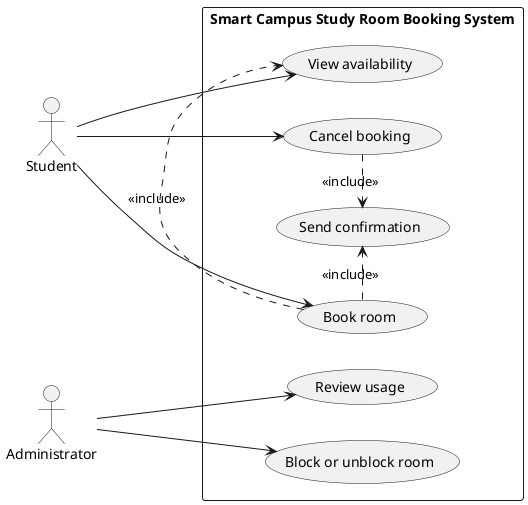

# Lab report — Practice #03, Requirements Engineering with AI

Fill in every section. **Do not delete or renumber the headings** — the README points at them and a
missing heading reads as a missing section.

Name: Barakhan Akniyet
Student ID: 24B031687
GitHub username: AknietBarakhan

---

## 1. Setup

| | |
| --- | --- |
| AI assistant (tool) | Claude|
| Exact model name and version | Free Sonnet 5|
| Date of the session | 27.09.26 |
| Diagram renderer used | |

One tool and one model for all three prompts. If you switched, say why here — it changes what your
findings mean.

---

## 2. Original AI output — user stories (Part 1)

Paste the **unedited** response to Prompt 1. Do not tidy it. If it is long, paste all of it anyway;
this is the baseline everything else is measured against.

```
# Smart Campus Study Room Booking System — User Stories

## Student Goals
- Find and reserve available rooms quickly
- Avoid conflicts or wasted trips to occupied rooms
- Manage or cancel their own bookings
- Get notified about booking status

## Administrator Goals
- Maintain oversight and control of room usage
- Prevent misuse (no-shows, overbooking)
- Configure system rules (hours, room capacity)
- Access usage data for reporting

---

### User Stories

**1.**
As a **student**, I want **to search for available study rooms by date, time, and capacity**, so that **I can quickly find a room that fits my group's needs**.
- **Priority:** High
- **Assumption:** Room availability data is updated in real time.

**2.**
As a **student**, I want **to book a room for a specific time slot**, so that **I can guarantee a space for my study session**.
- **Priority:** High
- **Assumption:** Each student is limited to one active booking per day to ensure fair access.

**3.**
As a **student**, I want **to receive a confirmation notification after booking**, so that **I have proof of my reservation and know the details are correct**.
- **Priority:** Medium
- **Assumption:** Students have a valid, verified email or app notification channel linked to their account.

**4.**
As a **student**, I want **to cancel or modify my existing booking**, so that **I can free up the room if my plans change**.
- **Priority:** High
- **Assumption:** Cancellations made after a certain cutoff time may still count against a no-show policy.

**5.**
As an **administrator**, I want **to view all current and upcoming room bookings**, so that **I can monitor usage and resolve conflicts if they arise**.
- **Priority:** High
- **Assumption:** The admin dashboard has read access to all booking records across the system.

**6.**
As an **administrator**, I want **to set booking rules such as maximum session length and operating hours**, so that **room usage stays fair and aligned with campus policy**.
- **Priority:** Medium
- **Assumption:** Rules apply globally by default but can be overridden per room if needed.

**7.**
As an **administrator**, I want **to flag or block students who repeatedly fail to show up for bookings**, so that **rooms are not held unnecessarily and remain available to others**.
- **Priority:** Medium
- **Assumption:** No-shows are tracked automatically when a booked room isn't checked into within a set grace period.

**8.**
As an **administrator**, I want **to generate reports on room usage over time**, so that **I can make informed decisions about resource allocation and future room capacity planning**.
- **Priority:** Low
- **Assumption:** Historical booking data is retained for at least one academic term.
```

---

## 3. Story review (Part 2)

One row per change you made. "Kept unchanged" is a valid row and needs a reason too.

| Story (as generated) | What I did | Why | Final ID |
| --- | --- | --- | --- |
| search for available study rooms by date, time, and capacity | removed the capacity filter | UC-01 only covers "which rooms are free, and when" | US-01 |
| book a room for a specific time slot | removed the "one booking per day" assumption | only R1-R4 are fixed for this system, and a daily limit is not among them | US-02 |
| receive a confirmation notification after booking | Kept, assumption softened | Matches UC-06 exactly, one testable outcome, no scope issues | US-04 |
| cancel or modify my existing booking | removed "or modify" and the no-show assumption | the no-show assumption implies a penalty policy, and payments/fees/fines/penalties are explicitly out of scope | US-03 |
| view all current and upcoming room bookings | Removed | monitoring bookings and reviewing usage are the same capability, not two testable outcomes | |
| set booking rules such as maximum session length and operating hours | Rewritten completely to cover blocking/unblocking a room | there is no "configure rules" use case. None of the 8 stories covered UC-04 | US-05 |
| flag or block students who repeatedly fail to show up | Removed | no-show tracking is attendance/check-in tracking, and blocking a student | |
| generate reports on room usage over time | Kept, wording tightened | Matches UC-05 Review usage exactly | US-06 |

**Did the assistant invent anything outside the scenario?** Name it against the out-of-scope list in
README section 1, or write "no, and here is how I checked".
Yes, it added. A room-capacity filter (story 1), an unstated one-booking-per-day limit (story 2), a "modify booking" action that isn't one of the six use cases (story 4), a no-show/penalty policy (stories 4 and 7 — payments/fees/fines/penalties are explicitly out of scope), configurable admin rules for session length and hours that contradict fixed rule R2 (story 6), and blocking a student rather than a room, which also implies check-in/attendance tracking (story 7 — also out of scope). 

**How many stories did you end with, and why that number?**
6
Because two generated stories were pure scope creep and had to go, one duplicated another, and one was rewritten because the model never covered UC-04 at all
---

## 4. Original AI output — acceptance criteria (Part 3)

```
# Acceptance Criteria

## Assumptions

- The system clock/timezone is authoritative for determining whether a booking start time is "in the future."
- A booking's duration is defined as (end time − start time); the maximum allowed duration is exactly two hours.
- "Overlap" means any intersection between the requested time slot and an existing confirmed booking for the same room (touching boundaries, e.g. one ends exactly when another starts, do not count as overlap).
- A room can be in one of two states: "available" or "blocked" (set by an Administrator); a blocked room rejects all new booking attempts regardless of time slot.
- Each booking is associated with exactly one student (the owner/creator), used to authorize cancellation.
- The system checks for overlapping bookings automatically before confirming a reservation (per US-02's stated assumption).
- Blocking a room does not automatically cancel existing bookings already made for it (per US-05's stated assumption); those bookings remain valid until they naturally expire or are individually cancelled.
- Only Administrators can block/unblock rooms; only the owning Student can cancel their own booking.

---

## US-02: Book a free room for a specific time slot

**Given** a room is available and the requested time slot is in the future, does not overlap any existing booking for that room, and lasts two hours or less
**When** the student submits the booking request
**Then** the system confirms the reservation and assigns the room to the student for that time slot

**Given** a room is available and the requested time slot does not overlap any existing booking
**When** the student submits a booking request with a start time in the past
**Then** the system rejects the request and displays an error indicating that bookings must be made for a future time

**Given** a room is available and the requested time slot is in the future
**When** the student submits a booking request for a duration longer than two hours
**Then** the system rejects the request and displays an error indicating that the maximum booking duration is two hours

**Given** a room already has a confirmed booking that overlaps the requested time slot
**When** the student submits a booking request for that overlapping time slot
**Then** the system rejects the request and displays an error indicating the room is already booked for that time

**Given** a room has been blocked by an Administrator
**When** the student submits a booking request for any time slot on that room
**Then** the system rejects the request and displays an error indicating the room is currently unavailable

---

## US-03: Cancel an existing booking

**Given** the student has a confirmed future booking
**When** the student requests to cancel that booking
**Then** the system cancels the booking and frees the room for that time slot

**Given** the student has a confirmed future booking
**When** the student attempts to cancel a booking that does not exist or has already been cancelled
**Then** the system rejects the request and displays an error indicating the booking cannot be found or is already cancelled

**Given** a booking exists but was made by a different student
**When** the student attempts to cancel that booking
**Then** the system rejects the request and displays an error indicating they are not authorized to cancel this booking

**Given** the student has a booking whose time slot has already started or passed
**When** the student attempts to cancel that booking
**Then** the system rejects the request and displays an error indicating that past or in-progress bookings cannot be cancelled

---

## US-05: Block and unblock a room

**Given** a room is currently available and has no status conflicts
**When** the Administrator blocks the room
**Then** the system marks the room as blocked, prevents any new bookings on it, and leaves existing bookings on that room unaffected

**Given** a room is currently blocked
**When** the Administrator unblocks the room
**Then** the system marks the room as available again and allows new bookings to be made on it, subject to normal rules

**Given** a room is already blocked
**When** the Administrator attempts to block the same room again
**Then** the system rejects the action (or returns a no-op confirmation) and displays a message indicating the room is already blocked

**Given** a room is already available (not blocked)
**When** the Administrator attempts to unblock it
**Then** the system rejects the action (or returns a no-op confirmation) and displays a message indicating the room is not currently blocked
```

---

## 5. Criteria review (Part 3)

| Criterion (as generated) | Problem | What I changed it to | Final ID |
| --- | --- | --- | --- |
| US-02 crit 1: happy path, "lasts two hours or less" | not tested as its own case | a normal-duration happy path, and a separate boundary case for a booking of exactly 2 hours | AC-01, AC-02 |
| US-02 crit 3: duration "longer than two hours" is rejected | No paired boundary happy-path criterion showing that exactly two hours is accepted | Kept unchanged, renumbered | AC-04 |
| US-02 crit 4: overlapping booking is rejected | | booking starting exactly at another's end time is accepted - added a new criteration | AC-05, AC-06 |
| US-03 crit 4: "past or in-progress bookings cannot be cancelled" | it silently adds a policy the assistant was never asked to apply | Removed | |
| US-05 crit 3: double-block "rejects the action | fails the "one action, one observable result" check | Reworded to - rejects with a message that the room is already blocked | AC-11 |
| US-05 crit 4: double-unblock "rejects the action" | Same problem as above | rejects with a message that the room is not currently blocked | AC-12 |

**The two open questions.** Write your decision and the reason. Either answer is accepted.

| Question | My decision | Why |
| --- | --- | --- |
| A booking ending exactly when another begins — overlap under R3? | allowed / not-allowed not allowed | Treating a shared boundary instant as a conflict would make back-to-back bookings impossible even though the rooms are never actually occupied by two people at once |
| Is exactly two hours allowed under R2? | allowed / not-allowed allowed | R2 says "at most two hours" and "at most" is inclusive of the limit itself |

**Which invalid or boundary case did the assistant leave out?**
А booking of exactly two hours being accepted and a booking that starts exactly when another one ends being accepted as non-overlapping. The assistant tested the rejected side of both rules, but never the accepted edge case
---

## 6. Original AI output — use-case diagram (Part 4)

```


**Design rationale:**
- **Student** is associated only with *View availability*, *Book room*, and *Cancel booking* — the actions a student actually performs.
- **Administrator** is associated only with *Block or unblock room* and *Review usage* — the administrative actions.
- **Send confirmation** has no direct actor association since no actor triggers it themselves; it's a system reaction, so it's connected only via `<<include>>` from *Book room* and *Cancel booking*, both of which logically require sending a confirmation on completion.
- **Book room** `<<include>>` **View availability**, since checking availability is a mandatory step within the booking process, not an optional variant — hence `include` rather than `extend`.
- No `<<extend>>` relationships were used, since none of the use cases have an optional, conditional behavior that clearly branches off another one — forcing one in would misrepresent the system's logic.
- No screens, databases, or internal classes are modeled, keeping the diagram at the business/use-case level as requested.
```

Rendered diagram (image, or a link): https://cdn-0.plantuml.com/plantuml/png/RP5FhzCm4CJl_XIZN029XyJhdmEggfQUk3Q2-zRPfalz9xATbWZntN7I2DA-thB-ZMScwqrC559hZJ9yJ4WUGUfJGYM1THBlL3oBQoYGHKFwJ3MNgJEC7fEh3Ij5Elc0ChKLkpHEsygAavW2vKcfVseKfSs1s95jsZXSwh3ttkAhzpcfHjd5nBR0RmMqaJL5Hl53-0gwa1WwY97K5Q28xxlFKr7lW92zHlWwXJjocWqEjvHHCRkxRhm-mmUqxj1_JgtcK-6UBxbEdgdcaI-cl6HNGNjtb62ft-4eMge_Iht3TbWGnUYr33ZYlNUcm_N4WK48J0RY4WVIFGV_ofkC7zIuOhoyhFj_VvXV7-QPKdUlC1xFdvuk-cRVd3RP0O7DhTX9cbnE6wRm4J_RcEGeNA7YXbrEqiAvLKx6fw4Glc2rafl9UlqVBD-0sNEmoRQjDNy1

---

## 7. Diagram review (Part 4)

| Element | Problem | What I changed |
| --- | --- | --- |
| UC02 .> UC01 : <<include>> | `include` means view availability is a mandatory sub-step of Book room, not just something students often do first | Kept unchanged, decision recorded here instead of left implicit |

**Associations.** Which actor–use-case links did the assistant draw that a person does not actually
trigger? Name them. None

**Did any screen, database or internal component appear as a use case or an actor?** No

---

## 8. Traceability (Part 5)

Summarise what the table in `requirements/traceability.md` shows:

- Use cases with **no story** behind them: none
- Stories with **no use case** they belong to: none
- Criteria that test **no rule** from section 1: none

**What does the largest gap tell you about the generated requirements?**
it is in coverage: only 3 of the 6 use cases because Part 3 only asked for criteria on three selected stories. UC-01 View availability, UC-05 Review usage, and UC-06 Send confirmation are fully specified as user stories but have never been tested with a Given/When/Then
---

## 9. Checker runs

Paste the **real terminal output** of both runs. A table with nothing behind it does not count.

```
$ python tests/check_requirements.py
FAIL   US-1  user-stories.md         2 TODO placeholder(s) left in the file
PASS   US-2  user-stories.md         6 stories, IDs US-01…US-06
PASS   US-3  user-stories.md         every story has the required sentence shape
PASS   US-4  user-stories.md         every story has a priority
PASS   US-5  user-stories.md         every story declares an assumption
PASS   US-6  user-stories.md         only Student and Administrator appear as roles
PASS   US-7  user-stories.md         nothing from the out-of-scope list appears
FAIL   AC-1  acceptance-criteria.md  38 TODO placeholder(s) left in the file
FAIL   AC-2  acceptance-criteria.md  0 story sections found, the task fixes this at 3
FAIL   AC-3  acceptance-criteria.md  no criteria found
PASS   AC-4  acceptance-criteria.md  all 9 criteria are complete Given/When/Then
FAIL   AC-5  acceptance-criteria.md  no story sections to check
PASS   AC-6  acceptance-criteria.md  30 assumptions listed before the criteria
PASS   AC-7  acceptance-criteria.md  both open questions are settled in the assumptions
FAIL   PU-1  use-cases.puml          2 TODO placeholder(s) left in the file
PASS   PU-2  use-cases.puml          exactly two actors: Student, Administrator
PASS   PU-3  use-cases.puml          all six use cases present
PASS   PU-4  use-cases.puml          system boundary present
PASS   PU-5  use-cases.puml          no screens, databases or internal components
PASS   PU-6  use-cases.puml          no unjustified actor associations found
FAIL   TR-1  traceability.md         2 TODO placeholder(s) left in the table
FAIL   TR-2  traceability.md         IDs that exist nowhere else: AC-10, AC-11, AC-12, AC-13
PASS   TR-3  traceability.md         every story appears in the table
------------------------------------------------------------------------
```

```
$ python tests/validate_submission.py
------------------------------------------------------------------------
PASS   schema                                    1
PASS   week                                      03
FAIL   student.name                              left empty
FAIL   student.student_id                        left empty
FAIL   student.github                            left empty
FAIL   assistant.tool                            left empty
FAIL   assistant.model                           left empty
FAIL   counts.user_stories                       left empty
PASS   counts.acceptance_criteria_sets           3
FAIL   checker.pass                              left empty — run the checker and report the result
FAIL   checker.fail                              left empty — run the checker and report the result
FAIL   checker.error                             left empty — run the checker and report the result
FAIL   checker.commit                            left empty
FAIL   assumptions.overlap_touching_bookings     not decided — either answer is accepted, no answer is not
FAIL   assumptions.exactly_two_hours             not decided — either answer is accepted, no answer is not
PASS   traceability.use_cases_not_covered        []
PASS   traceability.stories_not_traced           []
NOTE   traceability                              you are claiming full coverage in both directions — that is rare on a first pass, and it is checked
FAIL   review_findings                           three or more required, found 0
FAIL   honesty.can_explain_everything_submitted  answer yes or no
FAIL   honesty.ai_usage_disclosed                answer yes or no
------------------------------------------------------------------------
5 PASS · 15 FAIL · 0 ERROR · 1 note
Fix the FAIL and ERROR lines above, then run this again before you push.
```

| | PASS | FAIL | ERROR |
| --- | --- | --- | --- |
| `check_requirements.py` | 22 | 1 | 0 |

Commit these numbers were produced at (`git rev-parse --short HEAD`): 7dad1f4

**Every FAIL, one line each: what it is and what you decided to do about it.** A FAIL you report and
explain costs you nothing. AC-03 failed. US-02 had 6 acceptance criteria instead of the required 3-5

**Did you run the checks by hand instead of with Python?** Say so here — it costs nothing, but it
has to be said. No, I ran both checkers with Python.

---

## 10. Conclusion (150–200 words)

Answer all three:

1. Which part of the generated requirements was most wrong, and how would you have caught it without
   a checker? I think the most wrong was the user stories. AI added a room-capacity filter to US-01 that UC-01 never asked and created a penalty policy plus a block a student action and even payments, fines and check in tracking. I noticed that when I readed again every story line by line which I was to do manual
2. What did the assistant get right that would have taken you noticeably longer by hand? After writing acceptance criteria, "check_requirements.py" reported US-02 had 6 criteria instead of the allowed 3-5, because I had added both an "exactly two hours" boundary case and a general one without noticing the count.
3. You are handing these requirements to someone who will implement them, and you will not be in the
   room. Which single one would you rewrite first, and why? If I handed these requirements, I would rewrite US-01 first because "search rooms by date and time" says nothing about how the boundary of a time slot is treated, and that same ambiguity is exactly what caused the overlap question in R3 to need a written assumption here

Be specific. "The AI was useful" is worth nothing; "UC-06 had no story behind it until I wrote
US-07, and the checker is what told me" is worth everything.
